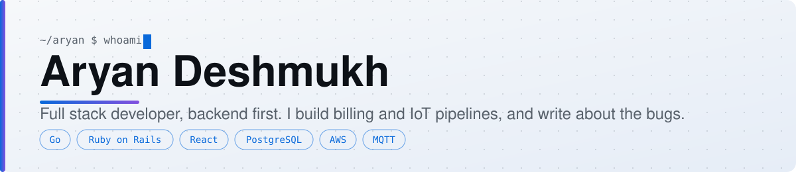
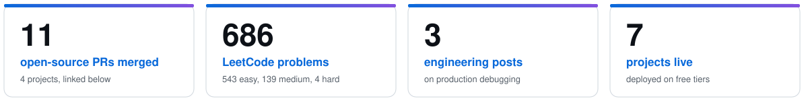

<picture>
  <source media="(prefers-color-scheme: dark)" srcset="assets/banner-dark.svg">
  
</picture>

 

[**Portfolio**](https://a-ryan-1.github.io/Portfolio-Website/) &nbsp;|&nbsp; [**LinkedIn**](https://www.linkedin.com/in/aryan-deshmukh-793840259/) &nbsp;|&nbsp; [**Medium**](https://medium.com/@aryan0deshmukh) &nbsp;|&nbsp; [**LeetCode**](https://leetcode.com/u/DarKKKKKnight/)

## About

I am a full stack developer with a backend focus at Josh Software in Pune, working on a production IoT water-metering and utility-billing platform. Meter readings arrive over MQTT into a Go service, a Ruby on Rails API turns them into bills, and React apps serve admins and residents, all on AWS. I own the billing module and built site onboarding end to end. My best stories come from production debugging, so I write them up.

Joined as an intern in January 2026 and converted to full-time in six months. B.Tech in Computer Engineering (Honours in Cyber Security), CGPA 9.26.

<picture>
  <source media="(prefers-color-scheme: dark)" srcset="assets/numbers-dark.svg">
  
</picture>

## What I work with

| | |
|---|---|
| **Languages** |      |
| **Backend** |     |
| **Frontend** |   |
| **Data and cloud** |     |

## Featured projects

All three are deployed and have a demo login in their README.

| Project | What it does | Stack |
|---|---|---|
| [**smart-rule-based-approval-engine**](https://github.com/A-RYAN-1/smart-rule-based-approval-engine) | Rules engine that auto-approves, escalates or rejects leave, expense and discount requests. [Live demo](https://smart-rule-based-approval-engine.vercel.app) | Go, Gin, PostgreSQL, React |
| [**fintech-fraud-detection**](https://github.com/A-RYAN-1/fintech-fraud-detection) | Real-time transaction fraud detection: Rails API with risk rules and Solid Queue, plus a React dashboard. I wrote the backend. [Live demo](https://fintech-fraud-detection-aryan.vercel.app) | Rails, PostgreSQL, React |
| [**node-connect**](https://github.com/A-RYAN-1/node-connect) | Decentralised chat with MetaMask sign-in and token rewards on a testnet. [Live demo](https://node-connect-sigma.vercel.app) | Solidity, Hardhat, Next.js |

## Open source

Merged pull requests, reviewed by the maintainers:

| Project | Change |
|---|---|
| [hluk/CopyQ](https://github.com/hluk/CopyQ)  | [Add option to hide the menu bar](https://github.com/hluk/CopyQ/pull/3732) and [hide the window frame](https://github.com/hluk/CopyQ/pull/3733) (C++, Qt) |
| [ONEARMY/community-platform](https://github.com/ONEARMY/community-platform)  | Migrated [Breadcrumbs](https://github.com/ONEARMY/community-platform/pull/4946), [CharacterCount](https://github.com/ONEARMY/community-platform/pull/4950) and the [admin layout breadcrumbs](https://github.com/ONEARMY/community-platform/pull/4954) to the shared UI library (React, TypeScript) |
| [sustainable-computing-io/kepler](https://github.com/sustainable-computing-io/kepler)  | Made the Helm chart run [unprivileged by default](https://github.com/sustainable-computing-io/kepler/pull/2584), fixed [pod attribution on cgroupfs nodes](https://github.com/sustainable-computing-io/kepler/pull/2591) it exposed, and added a [CI check](https://github.com/sustainable-computing-io/kepler/pull/2592) that fails when workload metrics disappear (Go, Helm, Kubernetes) |
| [prometheus-operator/prometheus-operator](https://github.com/prometheus-operator/prometheus-operator)  | Validation and config-generation fixes: [duplicate time intervals](https://github.com/prometheus-operator/prometheus-operator/pull/8896), [Webex credentials](https://github.com/prometheus-operator/prometheus-operator/pull/8897) and [Azure discovery settings](https://github.com/prometheus-operator/prometheus-operator/pull/8898) (Go, Kubernetes) |

More pull requests are open in cert-manager, OpenTelemetry Operator, Rook and Argo Rollouts; GitHub lists them under "Contributed to" on my profile.

Latest merged:

<!-- prs:start -->
- [sustainable-computing-io/kepler](https://github.com/sustainable-computing-io/kepler): [fix(helm): run the DaemonSet unprivileged by default](https://github.com/sustainable-computing-io/kepler/pull/2584), merged Oct 2026
- [prometheus-operator/prometheus-operator](https://github.com/prometheus-operator/prometheus-operator): [fix: keep Azure SD HTTP client settings in generated scrape config](https://github.com/prometheus-operator/prometheus-operator/pull/8898), merged Oct 2026
- [prometheus-operator/prometheus-operator](https://github.com/prometheus-operator/prometheus-operator): [fix: require httpConfig.authorization for Webex receivers](https://github.com/prometheus-operator/prometheus-operator/pull/8897), merged Oct 2026
- [prometheus-operator/prometheus-operator](https://github.com/prometheus-operator/prometheus-operator): [fix: reject duplicate time interval names in AlertmanagerConfig](https://github.com/prometheus-operator/prometheus-operator/pull/8896), merged Oct 2026
- [sustainable-computing-io/kepler](https://github.com/sustainable-computing-io/kepler): [fix(resource): match cgroupfs pod paths read from a cgroup namespace](https://github.com/sustainable-computing-io/kepler/pull/2591), merged Oct 2026
- [sustainable-computing-io/kepler](https://github.com/sustainable-computing-io/kepler): [ci(k8s): check workload metrics after the Helm install](https://github.com/sustainable-computing-io/kepler/pull/2592), merged Oct 2026
- [hluk/CopyQ](https://github.com/hluk/CopyQ): [Add option to hide the menu bar](https://github.com/hluk/CopyQ/pull/3732), merged Oct 2026
- [hluk/CopyQ](https://github.com/hluk/CopyQ): [Add option to hide the window frame](https://github.com/hluk/CopyQ/pull/3733), merged Oct 2026
<!-- prs:end -->

## Writing

Production bugs, written as stories with the measured fix.

- [The Water That Flowed Backwards](https://medium.com/@aryan0deshmukh/the-water-that-flowed-backwards-2a7d6bb04c7c): one line of Go made water meters report negative consumption, and the fix we added afterwards was the same bug in disguise.
- [The Restart Command That Only Worked When a Human Typed It](https://medium.com/@aryan0deshmukh/the-restart-command-that-only-worked-when-a-human-typed-it-941d30319d22): a supervisor ran the restart and failed every time. The command was right; the shell it ran in was not.
- [The Fix That Only Reached Half the Server](https://medium.com/@aryan0deshmukh/the-fix-that-only-reached-half-the-server-942aeb0665ac): we fixed a config file, restarted the app and watched one feature recover while the other kept failing for a day and a half.

## Get in touch

I am happy to talk about backend systems, IoT data pipelines and open source. The fastest way is [LinkedIn](https://www.linkedin.com/in/aryan-deshmukh-793840259/).
