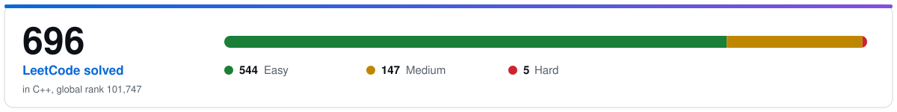

<picture>
  <source media="(prefers-color-scheme: dark)" srcset="assets/banner-dark.svg">
  
</picture>

 

[**Portfolio**](https://a-ryan-1.github.io/Portfolio-Website/) &nbsp;|&nbsp; [**LinkedIn**](https://www.linkedin.com/in/aryan-deshmukh-793840259/) &nbsp;|&nbsp; [**Medium**](https://medium.com/@aryan0deshmukh) &nbsp;|&nbsp; [**LeetCode**](https://leetcode.com/u/DarKKKKKnight/)

## About

I am a full stack developer with a backend focus at Josh Software in Pune, working on a production IoT water-metering and utility-billing platform. Meter readings arrive over MQTT into a Go service, a Ruby on Rails API turns them into bills, and React apps serve admins and residents, all on AWS. I own the billing module and built site onboarding end to end. My best stories come from production debugging, so I write them up.

Joined as an intern in January 2026 and converted to full-time in six months. B.Tech in Computer Engineering (Honours in Cyber Security), CGPA 9.26.

<!-- numbers:start -->
<picture>
  <source media="(prefers-color-scheme: dark)" srcset="assets/numbers-dark.svg">
  
</picture>
<!-- numbers:end -->

## What I work with

| | |
|---|---|
| **Languages** |       |
| **Backend** |       |
| **Frontend** |      |
| **Data** |     |
| **Cloud and DevOps** |        |

## Problem solving

Mostly easy and medium problems in C++, updated daily from my [LeetCode profile](https://leetcode.com/u/DarKKKKKnight/).

<picture>
  <source media="(prefers-color-scheme: dark)" srcset="assets/leetcode-dark.svg">
  
</picture>

## Selected fixes

Upstream fixes, each reproduced before claiming it, with the evidence in the PR.

### Actual Budget: bank sync outages now say what happened

- Failure: when SimpleFIN returned a maintenance page, the sync banner showed "An internal error occurred". The server had since learned to answer `SERVER_DOWN`, but the client had no mapping for it.
- Fix: a new `server-down` sync status carried through the account model, the database type and the error mapping, with its own banner message. No migration was needed because the column is free text.
- Result: three tests, one per layer, that fail without the change and pass with it; typecheck clean. [PR #9299](https://github.com/actualbudget/actual/pull/9299)

### CopyQ: a frameless window and a hidden menu bar

- Failure: users wanted a compact clipboard manager; the frameless option existed in code with no way to turn it on.
- Fix: proved dragging and resizing work on Wayland with a throwaway Qt window first, then built the checkbox, resize grip and drag-from-body; the menu bar collapses to zero height so its shortcuts still work.
- Result: eight review rounds across two PRs, both merged. [PR #3733](https://github.com/hluk/CopyQ/pull/3733), [#3732](https://github.com/hluk/CopyQ/pull/3732)
- Reuse: the menu bar commit is indexed in the [XERJ Corpus Hub](https://hub.xerj.org/contributors/A-RYAN-1) as a worked reference for AI coding agents, under CopyQ's GPL-3.0 licence with attribution.

### Prometheus Operator: bad AlertmanagerConfig and ScrapeConfig input caught early

- Failure: the operator accepted duplicate time intervals and credential-less Webex receivers that Alertmanager then refused, and its Azure discovery silently dropped settings.
- Fix: validation for both API versions, and the missing Azure fields written with the generator's own helpers.
- Result: every change pinned by tests that fail without it, including a golden-file case combining environment, authorization, proxy and redirects. [PR #8896](https://github.com/prometheus-operator/prometheus-operator/pull/8896), [#8897](https://github.com/prometheus-operator/prometheus-operator/pull/8897), [#8898](https://github.com/prometheus-operator/prometheus-operator/pull/8898)

## Contributions

<!-- logos:start -->

  
  
  
  
  
  

<!-- logos:end -->

<!-- contrib:start -->
| # | Project | What it is | Merged PRs | Stars |
|---|---|---|---|---|
| 1 | [actual](https://github.com/actualbudget/actual) | Local-first personal finance and budgeting app (TypeScript) | [#9299](https://github.com/actualbudget/actual/pull/9299) |  |
| 2 | [CopyQ](https://github.com/hluk/CopyQ) | Clipboard manager with advanced features (C++, Qt) | [#3732](https://github.com/hluk/CopyQ/pull/3732) [#3733](https://github.com/hluk/CopyQ/pull/3733) |  |
| 3 | [invoiceninja](https://github.com/invoiceninja/invoiceninja) | A source-available invoice, quote, project and time-tracking app built with Laravel | [#13402](https://github.com/invoiceninja/invoiceninja/pull/13402) |  |
| 4 | [Prometheus Operator](https://github.com/prometheus-operator/prometheus-operator) | Kubernetes operator for Prometheus and Alertmanager | [#8896](https://github.com/prometheus-operator/prometheus-operator/pull/8896) [#8897](https://github.com/prometheus-operator/prometheus-operator/pull/8897) [#8898](https://github.com/prometheus-operator/prometheus-operator/pull/8898) |  |
| 5 | [Kepler](https://github.com/sustainable-computing-io/kepler) | Energy use per Kubernetes pod and container, as Prometheus metrics | [#2584](https://github.com/sustainable-computing-io/kepler/pull/2584) [#2591](https://github.com/sustainable-computing-io/kepler/pull/2591) [#2592](https://github.com/sustainable-computing-io/kepler/pull/2592) [#2641](https://github.com/sustainable-computing-io/kepler/pull/2641) |  |
| 6 | [community-platform](https://github.com/ONEARMY/community-platform) | Precious Plastic community platform (React, TypeScript) | [#4946](https://github.com/ONEARMY/community-platform/pull/4946) [#4950](https://github.com/ONEARMY/community-platform/pull/4950) [#4954](https://github.com/ONEARMY/community-platform/pull/4954) |  |
<!-- contrib:end -->

Every merged PR of mine outside my own repos: [see the full list on GitHub](https://github.com/pulls?q=is%3Apr+author%3AA-RYAN-1+is%3Amerged+-user%3AA-RYAN-1).

The CopyQ menu bar commit is indexed in the [XERJ Corpus Hub](https://hub.xerj.org/contributors/A-RYAN-1) as reference code for AI coding agents.

<!-- open:start -->
Open now: [ollama](https://github.com/ollama/ollama), [litellm](https://github.com/BerriAI/litellm), [rclone](https://github.com/rclone/rclone), [tidb](https://github.com/pingcap/tidb), [chatwoot](https://github.com/chatwoot/chatwoot), [temporal](https://github.com/temporalio/temporal) and 7 more. GitHub lists them under "Contributed to" on this profile.
<!-- open:end -->

## Writing

Production bugs, written as stories with the measured fix.

- [The Water That Flowed Backwards](https://medium.com/@aryan0deshmukh/the-water-that-flowed-backwards-2a7d6bb04c7c): one line of Go made meters report negative consumption.
- [The Restart Command That Only Worked When a Human Typed It](https://medium.com/@aryan0deshmukh/the-restart-command-that-only-worked-when-a-human-typed-it-941d30319d22): the command was right; the shell was not.
- [The Fix That Only Reached Half the Server](https://medium.com/@aryan0deshmukh/the-fix-that-only-reached-half-the-server-942aeb0665ac): one feature recovered after a config fix while the other failed for a day and a half.

## Get in touch

I am happy to talk about backend systems, IoT data pipelines and open source. The fastest way is [LinkedIn](https://www.linkedin.com/in/aryan-deshmukh-793840259/).
