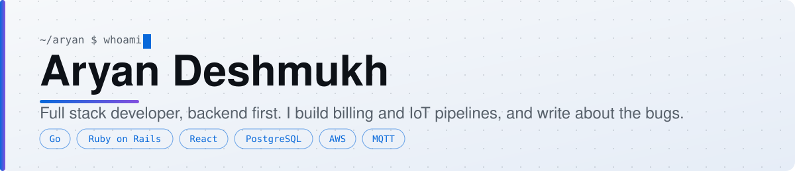
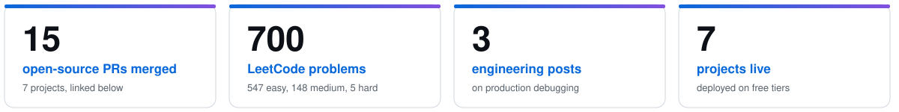
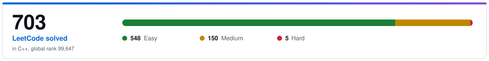

<picture>
  <source media="(prefers-color-scheme: dark)" srcset="assets/banner-dark.svg">
  
</picture>

 

[**Portfolio**](https://a-ryan-1.github.io/Portfolio-Website/) &nbsp;|&nbsp; [**Open source**](https://a-ryan-1.github.io/oss/) &nbsp;|&nbsp; [**Projects**](https://a-ryan-1.github.io/builds/) &nbsp;|&nbsp; [**Writing**](https://a-ryan-1.github.io/blogs/) &nbsp;|&nbsp; [**LinkedIn**](https://www.linkedin.com/in/aryan-deshmukh-793840259/) &nbsp;|&nbsp; [**Medium**](https://medium.com/@aryan0deshmukh) &nbsp;|&nbsp; [**LeetCode**](https://leetcode.com/u/DarKKKKKnight/)

## About

I am a full stack developer with a backend focus at Josh Software in Pune, working on a production IoT water-metering and utility-billing platform. Meter readings arrive over MQTT into a Go service, a Ruby on Rails API turns them into bills, and React apps serve admins and residents, all on AWS. I own the billing module and built site onboarding end to end. My best stories come from production debugging, so I write them up.

Joined as an intern in January 2026 and converted to full-time in six months. B.Tech in Computer Engineering (Honours in Cyber Security), CGPA 9.26.

<!-- numbers:start -->
<picture>
  <source media="(prefers-color-scheme: dark)" srcset="assets/numbers-dark.svg">
  
</picture>
<!-- numbers:end -->

## What I work with

| | |
|---|---|
| **Languages** |       |
| **Backend** |       |
| **Frontend** |      |
| **Data** |     |
| **Cloud and DevOps** |        |

## Problem solving

Mostly easy and medium problems in C++, updated daily from my [LeetCode profile](https://leetcode.com/u/DarKKKKKnight/).

<picture>
  <source media="(prefers-color-scheme: dark)" srcset="assets/leetcode-dark.svg">
  
</picture>

## Selected fixes

Upstream fixes, each reproduced before claiming it, with the evidence in the PR.

<!-- fixes:start -->
### rclone: the mount's background downloader limits are now flags

- Failure: streaming audio from a mount with `--vfs-cache-mode full` stopped and restarted its download thread every few seconds, because a 5 second idle limit and a 10 error limit were hard-coded in the downloader (issue #10148); a broken backend could also freeze a mount for minutes.
- Fix: two documented flags, `--vfs-cache-downloader-idle-time` and `--vfs-cache-downloader-max-errors`, carried through the existing VFS options struct, with defaults equal to the old constants so nothing changes unless set. The maintainer asked for the family's flag prefix, so I renamed them.
- Result: two timer-based tests (50 ms limit, `assert.Eventually`), merged in 21 days after one naming round and one approval. [PR #10171](https://github.com/rclone/rclone/pull/10171)

### TiDB: SOUNDEX() now exists, matching MySQL byte for byte

- Failure: `SELECT SOUNDEX(name)` failed with "FUNCTION soundex does not exist" (issue #3930, open since 2017), so a MySQL migration with SOUNDEX in a query broke outright. An earlier attempt had been closed unmerged.
- Fix: one encoder with three modes (UTF-8 characters, Latin-1 bytes, binary) chosen once when the signature is built, scalar and vectorized. A reviewer caught my first Latin-1 rule as a mismatch, so I read MySQL's own character table and tested all 256 leading bytes against a real MySQL 8.0.46.
- Result: merged in 19 days with two approvals, 12 files; the reviewer re-ran 65,792 Latin-1 cases independently, and a maintainer wrote the companion test PR. [PR #72222](https://github.com/pingcap/tidb/pull/72222)

### Actual Budget: bank sync outages now say what happened

- Failure: when SimpleFIN returned a maintenance page, the sync banner showed "An internal error occurred". The server had since learned to answer `SERVER_DOWN`, but the client had no mapping for it.
- Fix: a new `server-down` sync status carried through the account model, the database type and the error mapping, with its own banner message. No migration was needed because the column is free text.
- Result: three tests, one per layer, that fail without the change and pass with it; typecheck clean. [PR #9299](https://github.com/actualbudget/actual/pull/9299)
<!-- fixes:end -->

## Contributions

<!-- logos:start -->

  
  
  
  
  
  
  
  
  
  
  
  
  

<!-- logos:end -->

<!-- contrib:start -->
| # | Project | What it is | Merged PRs | Stars |
|---|---|---|---|---|
| 1 | [rclone](https://github.com/rclone/rclone) | "rsync for cloud storage" - Google Drive, S3, Dropbox, Backblaze B2, One Drive, Swift,... | [#10171](https://github.com/rclone/rclone/pull/10171) |  |
| 2 | [tidb](https://github.com/pingcap/tidb) | TiDB is built for agentic workloads that grow unpredictably, with ACID guarantees and... | [#72222](https://github.com/pingcap/tidb/pull/72222) |  |
| 3 | [actual](https://github.com/actualbudget/actual) | Local-first personal finance and budgeting app (TypeScript) | [#9299](https://github.com/actualbudget/actual/pull/9299) |  |
| 4 | [rook](https://github.com/rook/rook) | Storage Orchestration for Kubernetes | [#18598](https://github.com/rook/rook/pull/18598) |  |
| 5 | [CopyQ](https://github.com/hluk/CopyQ) | Clipboard manager with advanced features (C++, Qt) | [#3732](https://github.com/hluk/CopyQ/pull/3732) [#3733](https://github.com/hluk/CopyQ/pull/3733) |  |
| 6 | [invoiceninja](https://github.com/invoiceninja/invoiceninja) | A source-available invoice, quote, project and time-tracking app built with Laravel | [#13402](https://github.com/invoiceninja/invoiceninja/pull/13402) |  |
| 7 | [Prometheus Operator](https://github.com/prometheus-operator/prometheus-operator) | Kubernetes operator for Prometheus and Alertmanager | [#8896](https://github.com/prometheus-operator/prometheus-operator/pull/8896) [#8897](https://github.com/prometheus-operator/prometheus-operator/pull/8897) [#8898](https://github.com/prometheus-operator/prometheus-operator/pull/8898) |  |
| 8 | [external-dns](https://github.com/kubernetes-sigs/external-dns) | Configure external DNS servers dynamically from Kubernetes resources | [#6827](https://github.com/kubernetes-sigs/external-dns/pull/6827) |  |
| 9 | [mockery](https://github.com/vektra/mockery) | A mock code autogenerator for Go | [#1207](https://github.com/vektra/mockery/pull/1207) |  |
| 10 | [tortoise-orm](https://github.com/tortoise/tortoise-orm) | Familiar asyncio ORM for python, built with relations in mind | [#2387](https://github.com/tortoise/tortoise-orm/pull/2387) |  |
| 11 | [Kepler](https://github.com/sustainable-computing-io/kepler) | Energy use per Kubernetes pod and container, as Prometheus metrics | [#2584](https://github.com/sustainable-computing-io/kepler/pull/2584) [#2591](https://github.com/sustainable-computing-io/kepler/pull/2591) [#2592](https://github.com/sustainable-computing-io/kepler/pull/2592) [#2641](https://github.com/sustainable-computing-io/kepler/pull/2641) [#2709](https://github.com/sustainable-computing-io/kepler/pull/2709) |  |
| 12 | [community-platform](https://github.com/ONEARMY/community-platform) | Precious Plastic community platform (React, TypeScript) | [#4946](https://github.com/ONEARMY/community-platform/pull/4946) [#4950](https://github.com/ONEARMY/community-platform/pull/4950) [#4954](https://github.com/ONEARMY/community-platform/pull/4954) [#5039](https://github.com/ONEARMY/community-platform/pull/5039) |  |
| 13 | [casa](https://github.com/rubyforgood/casa) | Multi-tenant case management for CASA child-advocacy programs (Ruby on Rails) | [#7319](https://github.com/rubyforgood/casa/pull/7319) |  |
<!-- contrib:end -->

<!-- open:start -->
Open now: [ollama #19363](https://github.com/ollama/ollama/pull/19363), [next.js #101643](https://github.com/vercel/next.js/pull/101643), [litellm #50038 (+1)](https://github.com/BerriAI/litellm/pull/50038), [rclone #10183](https://github.com/rclone/rclone/pull/10183), [gorm #7898](https://github.com/go-gorm/gorm/pull/7898), [chatwoot #16388](https://github.com/chatwoot/chatwoot/pull/16388) and [13 more](https://github.com/pulls?q=is%3Apr+is%3Aopen+draft%3Afalse+author%3AA-RYAN-1+-user%3AA-RYAN-1).
<!-- open:end -->

---

## Reference code for AI agents

<!-- xerj:start -->
My merged work is indexed in the [XERJ Corpus Hub](https://hub.xerj.org/contributors/A-RYAN-1) as worked reference code for AI coding agents: [CopyQ](https://github.com/hluk/CopyQ).
<!-- xerj:end -->

---

## Writing

Production bugs, written as stories with the measured fix.

<!-- writing:start -->
- [The Line git blame Can’t See](https://medium.com/@aryan0deshmukh/the-line-git-blame-cant-see-b151afd654f1): git blame tells you who touched a line last. For a line that’s already been deleted, it has no answer at all.
- [The Fix That Only Reached Half the Server](https://medium.com/@aryan0deshmukh/the-fix-that-only-reached-half-the-server-942aeb0665ac): We fixed a config file, restarted the app and watched one feature recover. The other kept failing for a day and a half.
- [The Restart Command That Only Worked When a Human Typed It](https://medium.com/@aryan0deshmukh/the-restart-command-that-only-worked-when-a-human-typed-it-941d30319d22): A supervisor noticed the crash, ran the restart and failed every time. The command was right. The shell it ran in was not.
- [The Water That Flowed Backwards](https://medium.com/@aryan0deshmukh/the-water-that-flowed-backwards-2a7d6bb04c7c): What the meters actually report
<!-- writing:end -->

## Get in touch

I am happy to talk about backend systems, IoT data pipelines and open source. The fastest way is [LinkedIn](https://www.linkedin.com/in/aryan-deshmukh-793840259/).
